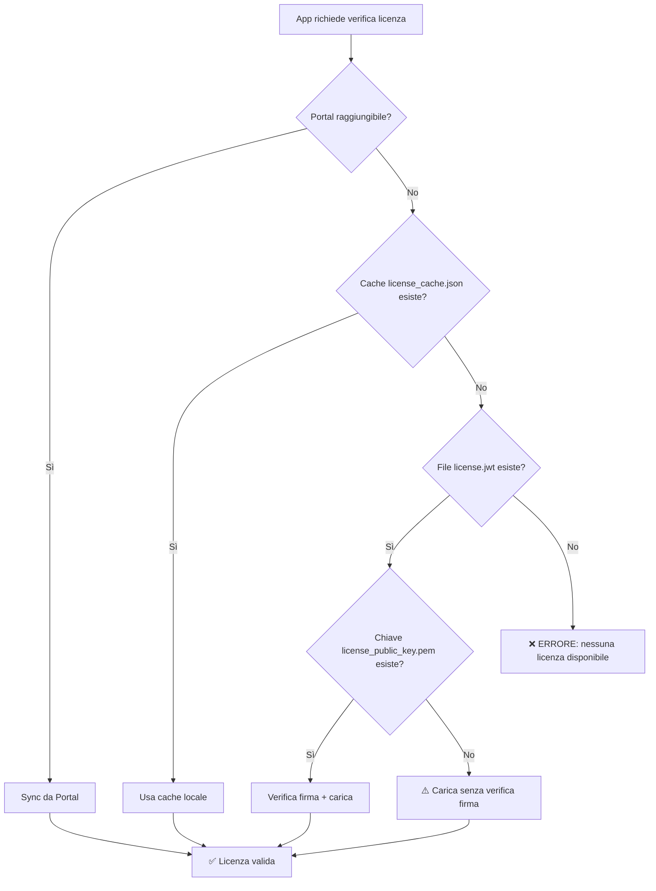

# Fallback Licenza Locale - Guida Emergenza

## Quando Usare il Fallback Locale

Il fallback a file licenza locale (`license.jwt`) è pensato per situazioni di **emergenza**:
- ❌ Portal PramaIA non raggiungibile per guasto rete/server
- ❌ Nessuna cache locale disponibile (`license_cache.json` assente o scaduta)
- ✅ App deve continuare a funzionare temporaneamente

**⚠️ DISCLAIMER**: Questo meccanismo bypassa il sync Portal e non riceve aggiornamenti automatici. Usare solo come ultima risorsa.

---

## Setup Fallback Locale

### 1. Generazione Chiavi RSA (se non già disponibili)

```bash
# Genera coppia chiavi
openssl genpkey -algorithm RSA -out license_private_key.pem -pkeyopt rsa_keygen_bits:2048

# Estrai chiave pubblica
openssl rsa -pubout -in license_private_key.pem -out license_public_key.pem
```

**⚠️ SICUREZZA**:
- `license_private_key.pem` → Conservare in vault sicuro (non nella repo!)
- `license_public_key.pem` → Copiare nella root dell'app

### 2. Creazione Token Licenza

Usare script Python per generare `license.jwt`:

```python
import jwt
from datetime import datetime, timedelta

# Payload licenza (esempio)
payload = {
    "license_id": "LIC-EMERGENCY-001",
    "customer": {
        "customer_id": "CUST123",
        "name": "Cliente XYZ"
    },
    "entitlements": {
        "modules": ["base", "albo"],  # Moduli attivi
        "max_users": 100,
        "max_instances": 5
    },
    "validity": {
        "issued_at": datetime.utcnow().isoformat(),
        "expires_at": (datetime.utcnow() + timedelta(days=365)).isoformat(),
        "maintenance_until": (datetime.utcnow() + timedelta(days=365)).isoformat()
    },
    "deployment": {
        "allowed_types": ["on_prem"],
        "allowed_versions": ["*"]
    }
}

# Firma con chiave privata
with open("license_private_key.pem", "rb") as f:
    private_key = f.read()

token = jwt.encode(payload, private_key, algorithm="RS256")

# Salva token
with open("license.jwt", "w") as f:
    f.write(token)

print("✅ license.jwt generato")
```

### 3. Deploy File

Copiare nella root dell'app:
```
app-root/
├── license.jwt                    # Token firmato
├── license_public_key.pem         # Chiave pubblica per verifica
└── ...
```

**Non committare questi file** → già esclusi in `.gitignore`

---

## Flusso Fallback



---

## Verifica Manuale Firma

Per verificare che il token sia valido prima del deploy:

```bash
# Installa jwt-cli (opzionale)
# https://github.com/mike-engel/jwt-cli

jwt decode $(cat license.jwt) --secret @license_public_key.pem --alg RS256
```

---

## Limitazioni Fallback Locale

1. **Nessun aggiornamento automatico**: payload fisso fino a prossimo sync Portal
2. **Nessun audit Portal**: controlli utente/istanze non sincronizzati
3. **Senza chiave pubblica**: firma non verificata (vulnerabile a manomissioni)
4. **Scadenza hardcoded**: se expires_at nel passato → app bloccata

**Raccomandazione**: Ripristinare connessione Portal al più presto.

---

## Monitoraggio

### API License Status

```bash
curl -H "Authorization: Bearer $ADMIN_TOKEN" \
  http://localhost:8000/api/license/status
```

Risposta con fallback locale:
```json
{
  "valid": true,
  "code": "OK",
  "sync_status": "local_file",     // ← Indica uso file locale
  "last_sync_at": null,
  "license_id": "LIC-EMERGENCY-001"
}
```

### Logs Backend

```
INFO:license_service:Attempting to load local license file (fallback mode)
INFO:license_service:Using local license file: LIC-EMERGENCY-001
```

---

## Ritorno al Modello Portal

Quando Portal è di nuovo raggiungibile:

1. **Sync manuale**:
   ```bash
   POST /api/license/sync
   ```

2. **Verifica status**:
   ```bash
   GET /api/license/status
   # → sync_status dovrebbe tornare "ok"
   ```

3. **(Opzionale) Rimuovi fallback locale**:
   ```bash
   rm license.jwt license_public_key.pem
   ```

---

## FAQ

### Il file locale sovrascrive la cache Portal?

❌ No. L'ordine è sempre: **Portal → Cache → File locale**

### Posso usare solo file locale senza Portal?

⚠️ Sì, ma sconsigliato. Ometti `PORTAL_URL` in `.env` → solo file locale.

### Cosa succede se license.jwt è scaduto?

❌ App bloccata. Validazione date sempre attiva.

### Posso rigenerare license.jwt con scadenza estesa?

✅ Sì, ma richiede chiave privata originale. Meglio risolvere problema Portal.

---

## Supporto

Per problemi con license verification:
- Controllare logs: `backend/main.py`
- Tabella audit: `license_logs`
- Documentazione: `LICENSE_SYSTEM_README.md`
