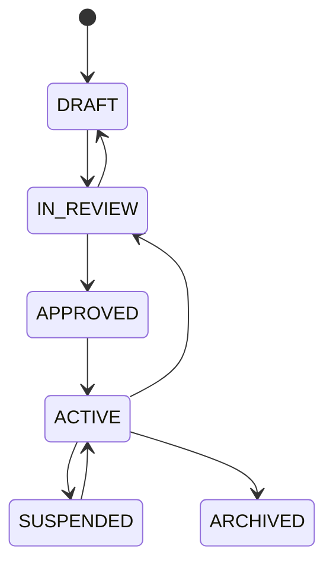
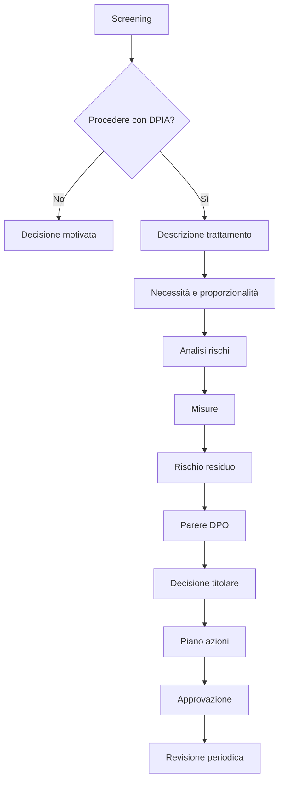
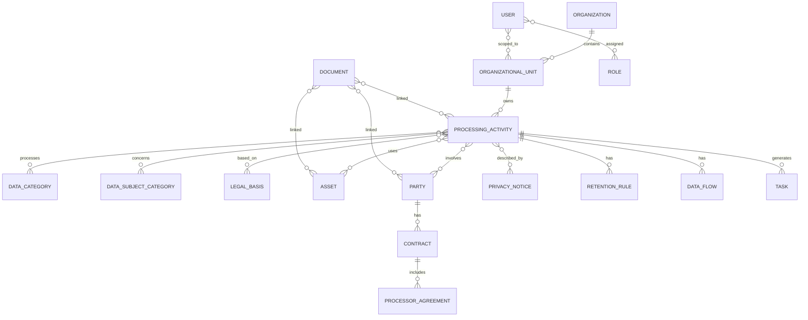
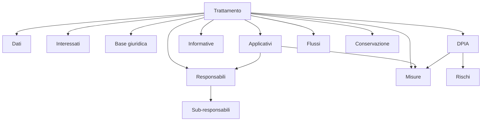

# PrivacyPA
## Specifica funzionale e tecnica per un sistema di gestione della privacy e dell’accountability in un ente pubblico

**Versione:** 1.0  
**Data:** 17 settembre 2026  
**Destinatari:** Product Owner, software house, analisti funzionali, UX/UI designer, sviluppatori backend/frontend, DBA, DevOps, sicurezza, DPO/RPD, RTD, referenti privacy  
**Contesto principale:** Comune / ente pubblico italiano  
**Stato documento:** baseline per analisi, stima e sviluppo MVP  

---

# 1. Scopo del documento

Questo documento definisce i requisiti funzionali e tecnici di **PrivacyPA**, una piattaforma web per la gestione integrata degli adempimenti in materia di protezione dei dati personali in un ente pubblico.

Il prodotto non deve essere concepito come un semplice registro elettronico o repository documentale. Deve essere un **Privacy Management System** capace di:

- mantenere un quadro aggiornato dei trattamenti;
- collegare trattamenti, strutture organizzative, sistemi, fornitori, dati, interessati, rischi, misure e documenti;
- supportare gli adempimenti del GDPR e della normativa nazionale;
- pianificare scadenze e responsabilità;
- governare DPIA, data breach, richieste degli interessati, audit e azioni correttive;
- conservare evidenze e storico delle decisioni;
- supportare DPO/RPD, referenti privacy, dirigenti, ICT e RTD;
- generare report e documentazione;
- consentire future integrazioni con protocollo, gestione documentale, directory utenti, sistemi HR, SIEM e altri applicativi;
- introdurre automazioni e strumenti IA senza sostituire le valutazioni umane.

---

# 2. Principi progettuali

## 2.1 Single source of truth

Ogni informazione deve essere censita una sola volta e riutilizzata nei diversi moduli.

Esempio:

- il software “Gestionale Servizi Sociali” esiste una sola volta;
- può essere collegato a 15 trattamenti;
- è associato a un fornitore;
- ha determinate misure di sicurezza;
- può essere coinvolto in una DPIA;
- può essere coinvolto in un data breach.

Non devono esistere copie indipendenti dello stesso oggetto in moduli differenti.

## 2.2 Registro dei trattamenti come dominio centrale

Il registro delle attività di trattamento rappresenta il nodo centrale del sistema.

I moduli devono essere progettati intorno alle relazioni:

```text
TRATTAMENTO
 ├── struttura organizzativa
 ├── responsabile interno
 ├── finalità
 ├── basi giuridiche
 ├── categorie di interessati
 ├── categorie di dati
 ├── destinatari
 ├── sistemi/applicativi
 ├── fornitori/responsabili
 ├── sub-responsabili
 ├── flussi di dati
 ├── conservazione
 ├── misure di sicurezza
 ├── rischi
 ├── DPIA
 ├── informative
 ├── trasferimenti internazionali
 ├── incidenti/data breach
 ├── richieste interessati
 └── documenti/evidenze
```

## 2.3 Accountability by design

Ogni processo rilevante deve registrare:

- chi ha operato;
- cosa ha fatto;
- quando;
- su quale oggetto;
- motivazione, quando richiesta;
- eventuale approvazione;
- documento/evidenza associata;
- valore precedente e nuovo valore, quando applicabile.

## 2.4 Nessun “punteggio di conformità GDPR” assoluto

Il sistema non deve mostrare indicatori come:

> Conformità GDPR: 87%

Sono ammessi indicatori oggettivi:

- 14 trattamenti da revisionare;
- 3 azioni correttive scadute;
- 7 informative da verificare;
- 4 responsabili senza documentazione completa.

## 2.5 Human in the loop

Automazioni e IA possono:

- suggerire;
- evidenziare anomalie;
- precompilare;
- estrarre informazioni;
- generare bozze.

Non devono assumere automaticamente decisioni giuridiche definitive.

---

# 3. Riferimenti normativi e di contesto

La progettazione deve tenere conto almeno di:

- Regolamento (UE) 2016/679 – GDPR;
- d.lgs. 30 giugno 2003, n. 196, nel testo vigente;
- d.lgs. 10 agosto 2018, n. 101;
- provvedimenti e linee guida del Garante per la protezione dei dati personali;
- Linee guida EDPB applicabili;
- Codice dell’Amministrazione Digitale – d.lgs. 82/2005;
- Linee guida AgID su formazione, gestione e conservazione dei documenti informatici;
- requisiti e indicazioni ACN applicabili alle infrastrutture e ai servizi cloud della PA;
- normativa e linee guida sull’accessibilità dei servizi digitali della PA;
- obblighi di trasparenza e pubblicità legale, ove pertinenti.

## 3.1 Riferimenti ufficiali utili

- GDPR: https://eur-lex.europa.eu/eli/reg/2016/679/oj?locale=IT
- Codice privacy vigente: https://www.normattiva.it/eli/id/2003/07/29/003G0218/
- d.lgs. 101/2018: https://www.normattiva.it/eli/id/2018/09/04/18G00129/
- Garante – principi fondamentali e registro: https://www.garanteprivacy.it/home/principi-fondamentali-del-trattamento
- Garante – DPIA: https://www.garanteprivacy.it/valutazione-d-impatto-della-protezione-dei-dati-dpia-
- Garante – elenco trattamenti soggetti a DPIA: https://www.garanteprivacy.it/home/docweb/-/docweb-display/docweb/9058979
- Garante – data breach: https://www.garanteprivacy.it/data-breach
- AgID – Linee guida: https://www.agid.gov.it/it/linee-guida
- AgID – gestione documentale: https://www.agid.gov.it/it/ambiti-intervento/gestione-documentale

> Nota: i riferimenti normativi devono essere trattati come configurazione/versione documentale e non hard-coded nella logica applicativa. Devono poter essere aggiornati senza modifica del codice.

---

# 4. Ambito del prodotto

## 4.1 Moduli previsti a regime

1. Dashboard e control room
2. Organizzazione
3. Registro dei trattamenti
4. Categorie dati/interessati/basi giuridiche
5. Sistemi e asset informativi
6. Fornitori e responsabili art. 28
7. Sub-responsabili
8. Flussi di dati
9. Conservazione
10. Misure di sicurezza
11. Analisi dei rischi
12. DPIA
13. Trasferimenti internazionali
14. Informative
15. Data breach
16. Esercizio dei diritti
17. Audit
18. Azioni correttive
19. Privacy by design / nuovi progetti
20. Formazione
21. Autorizzazioni al trattamento
22. Documenti ed evidenze
23. Scadenze e task
24. Workflow e approvazioni
25. Motore di regole
26. Reportistica
27. Relazione annuale privacy
28. DPO Workspace
29. Ricerca globale
30. API e integrazioni
31. Assistente IA

---

# 5. MVP

L’MVP deve includere:

1. autenticazione e utenti;
2. organizzazione;
3. registro trattamenti;
4. cataloghi;
5. sistemi/applicativi;
6. fornitori/responsabili;
7. documenti;
8. task/scadenze;
9. versionamento;
10. audit trail;
11. dashboard;
12. report Registro art. 30;
13. ricerca base;
14. notifiche.

## 5.1 Fuori MVP

Da posticipare:

- DPIA completa;
- risk engine avanzato;
- data breach;
- richieste interessati;
- audit strutturati;
- privacy by design;
- formazione;
- autorizzazioni;
- IA;
- integrazioni con protocollo;
- query builder avanzato;
- SIEM;
- conservazione digitale automatizzata.

La struttura dati dell’MVP deve comunque essere compatibile con i moduli futuri.

---

# 6. Architettura applicativa

## 6.1 Approccio

Per MVP e prime release utilizzare un **monolite modulare**, non microservizi.

Motivazioni:

- minore complessità operativa;
- transazioni più semplici;
- deployment più lineare;
- minore costo di manutenzione;
- possibilità di estrazione futura di moduli.

## 6.2 Stack suggerito

### Frontend

Opzioni:

- React + Next.js;
- oppure Vue/Nuxt.

Preferenza: **React + Next.js + TypeScript**.

### Backend

Opzioni preferite:

- .NET 8+;
- Java Spring Boot.

Preferenza progettuale: **.NET LTS + C#** oppure **Java LTS + Spring Boot**.

### Database

**PostgreSQL**.

### Object storage

S3-compatible o equivalente, con:

- versioning;
- cifratura;
- checksum;
- retention configurabile;
- integrazione antivirus/antimalware.

### Cache / queue

Redis o equivalente.

### Ricerca

MVP:

- PostgreSQL full-text search;
- trigram indexes.

Evoluzione:

- OpenSearch/Elasticsearch.

## 6.3 Moduli backend

```text
PrivacyPA
├── Identity
├── Organization
├── ProcessingActivities
├── Catalogs
├── Assets
├── Processors
├── Documents
├── Tasks
├── Workflow
├── Notifications
├── Reporting
├── AuditTrail
├── Risk
├── DPIA
├── Breaches
├── Rights
├── Audits
├── Projects
└── AI
```

I moduli futuri possono essere inizialmente disabilitati tramite feature flag.

---

# 7. Modello multi-ente

Il prodotto deve essere predisposto per supportare più enti.

Ogni record di dominio deve essere associato a:

```text
tenant_id
```

Requisiti:

- separazione logica forte;
- nessuna query di dominio senza tenant scope;
- impossibilità di accesso cross-tenant salvo ruolo tecnico esplicitamente autorizzato;
- backup/restoring per tenant, ove possibile;
- configurazioni per ente.

Per installazioni single-tenant il modello resta comunque valido.

---

# 8. Organizzazione

## 8.1 Entità

### organizations

```text
id UUID PK
tenant_id UUID
name varchar
tax_code varchar
ipa_code varchar nullable
pec varchar nullable
address jsonb nullable
dpo_name varchar nullable
dpo_contact varchar nullable
active boolean
created_at timestamptz
updated_at timestamptz
```

### organizational_units

```text
id UUID PK
tenant_id UUID
parent_id UUID nullable FK organizational_units
code varchar
name varchar
unit_type enum
manager_user_id UUID nullable
active boolean
valid_from date
valid_to date nullable
```

Tipi indicativi:

- area;
- settore;
- servizio;
- ufficio;
- unità;
- comando;
- istituzione.

Deve essere supportata una struttura gerarchica arbitraria.

---

# 9. Identity e ruoli

## 9.1 Utenti

### users

```text
id UUID PK
tenant_id UUID
external_subject_id varchar nullable
username varchar
email varchar
first_name varchar
last_name varchar
enabled boolean
last_login_at timestamptz nullable
created_at timestamptz
updated_at timestamptz
```

Evitare memorizzazione di password se disponibile autenticazione federata.

## 9.2 Ruoli

Ruoli applicativi iniziali:

- SUPER_ADMIN
- TENANT_ADMIN
- PRIVACY_MANAGER
- DPO
- MANAGER
- PRIVACY_REFERENT
- ICT
- RTD
- OPERATOR
- AUDITOR
- READ_ONLY

## 9.3 Scope

Il ruolo deve poter essere limitato:

- all’intero ente;
- a una struttura;
- a un sottoalbero organizzativo;
- a singoli record.

### user_role_assignments

```text
id UUID PK
tenant_id UUID
user_id UUID
role_code varchar
organizational_unit_id UUID nullable
scope_type enum
valid_from timestamptz
valid_to timestamptz nullable
```

---

# 10. Autorizzazione

Utilizzare **RBAC + scope organizzativo + policy record-level**.

Esempio:

```text
privacy_referent
unit = SERVIZI_SOCIALI

can:
  view processing activities in unit
  edit draft processing activities in unit
  create tasks
  upload documents

cannot:
  approve processing activity
  view restricted breaches outside scope
  change security configuration
```

## 10.1 Matrice azioni

Ogni modulo deve almeno distinguere:

- view;
- create;
- edit;
- submit;
- approve;
- reopen;
- archive;
- export;
- delete logical;
- administer.

---

# 11. Registro dei trattamenti

## 11.1 Entità principale

### processing_activities

```text
id UUID PK
tenant_id UUID
code varchar unique per tenant
title varchar
description text
status enum
organizational_unit_id UUID
owner_user_id UUID nullable
privacy_referent_user_id UUID nullable

purpose_summary text
source_of_data text nullable
collection_method text nullable
mandatory_provision boolean nullable
automated_decision boolean default false
profiling boolean default false

start_date date nullable
last_review_date date nullable
next_review_date date nullable

confidentiality_level enum

version_no integer
is_current boolean
created_by UUID
created_at timestamptz
updated_by UUID
updated_at timestamptz
```

## 11.2 Stati

```text
DRAFT
IN_REVIEW
APPROVED
ACTIVE
SUSPENDED
ARCHIVED
```

Transizioni ammesse configurabili.

Esempio:



## 11.3 Codifica

Codice leggibile:

```text
TR-000001
```

Numerazione per tenant.

Non usare il codice come primary key.

---

# 12. Finalità

### processing_purposes

```text
id UUID PK
processing_activity_id UUID
description text
order_no integer
```

Una attività può avere più finalità.

---

# 13. Basi giuridiche

Le basi giuridiche GDPR e i riferimenti normativi specifici devono essere separati.

### legal_basis_catalog

```text
code
article
paragraph
letter
description
```

Esempi:

```text
GDPR_6_1_C
GDPR_6_1_E
GDPR_6_1_A
GDPR_9_2_G
GDPR_9_2_H
GDPR_10
```

### processing_legal_bases

```text
id UUID
processing_activity_id UUID
legal_basis_code varchar
notes text nullable
```

### legal_references

```text
id UUID
tenant_id UUID
source_type enum
title varchar
number varchar nullable
year integer nullable
article varchar nullable
url varchar nullable
notes text nullable
```

### processing_legal_references

```text
processing_activity_id UUID
legal_reference_id UUID
purpose_id UUID nullable
```

---

# 14. Interessati

### data_subject_category_catalog

Esempi:

- cittadini;
- utenti servizi;
- dipendenti;
- amministratori;
- minori;
- familiari;
- fornitori;
- professionisti;
- richiedenti;
- segnalanti;
- soggetti vulnerabili.

### processing_data_subjects

```text
processing_activity_id UUID
category_id UUID
notes text nullable
approx_volume_range varchar nullable
```

---

# 15. Categorie di dati

### data_category_catalog

Struttura gerarchica.

```text
id UUID
parent_id UUID nullable
code varchar
name varchar
gdpr_class enum
description text
```

`gdpr_class`:

```text
ORDINARY
SPECIAL_ART9
CRIMINAL_ART10
```

Esempi:

```text
Identificativi
 ├ nome/cognome
 ├ codice fiscale
 ├ data nascita

Contatto
 ├ indirizzo
 ├ email
 └ telefono

Economico/patrimoniali
 ├ reddito
 ├ ISEE
 └ IBAN

Art. 9
 ├ salute
 ├ origine razziale/etnica
 ├ convinzioni religiose
 ├ dati biometrici
 └ vita/orientamento sessuale
```

### processing_data_categories

```text
processing_activity_id UUID
data_category_id UUID
notes text nullable
```

---

# 16. Destinatari

### recipient_entities

Può contenere:

- altro ente;
- autorità;
- soggetto privato;
- categoria generica.

### processing_recipients

```text
processing_activity_id
recipient_id
communication_type enum
legal_reference_id nullable
notes
```

`communication_type`:

- COMMUNICATION;
- DISCLOSURE;
- PUBLICATION;
- INTERNAL_ACCESS.

---

# 17. Sistemi e asset

## 17.1 assets

```text
id UUID
tenant_id UUID
code varchar
name varchar
asset_type enum
description text
supplier_id UUID nullable
owner_unit_id UUID nullable

hosting_type enum
cloud_service boolean
hosting_country varchar nullable
data_location_notes text nullable

authentication_type varchar nullable
mfa_supported boolean nullable
logging_supported boolean nullable
encryption_at_rest boolean nullable
encryption_in_transit boolean nullable
backup_enabled boolean nullable

lifecycle_status enum
go_live_date date nullable
retirement_date date nullable

confidentiality_level enum
created_at
updated_at
```

`asset_type`:

- APPLICATION;
- DATABASE;
- FILE_SHARE;
- PAPER_ARCHIVE;
- SERVER;
- CLOUD_SERVICE;
- DEVICE_CLASS;
- INTEGRATION;
- OTHER.

`lifecycle_status`:

- PLANNED;
- ACTIVE;
- LEGACY;
- DISMISSION;
- DISMISSED.

## 17.2 Relazione trattamenti-sistemi

### processing_assets

```text
processing_activity_id UUID
asset_id UUID
role enum
notes text nullable
```

Ruoli:

- COLLECTION;
- STORAGE;
- PROCESSING;
- EXCHANGE;
- ARCHIVE;
- PUBLICATION.

---

# 18. Fornitori e responsabili

## 18.1 parties

Per evitare anagrafiche duplicate usare entità generica.

### parties

```text
id UUID
tenant_id UUID
party_type enum
legal_name varchar
tax_id varchar nullable
vat_id varchar nullable
pec varchar nullable
email varchar nullable
country_code char(2) nullable
address jsonb nullable
website varchar nullable
notes text nullable
```

`party_type`:

- PROCESSOR;
- JOINT_CONTROLLER;
- RECIPIENT;
- SUPPLIER;
- PUBLIC_BODY;
- OTHER.

## 18.2 Responsabili

### processor_profiles

```text
party_id UUID PK
dpo_contact text nullable
security_contact text nullable
privacy_contact text nullable
status enum
last_assessment_date date nullable
next_assessment_date date nullable
```

## 18.3 Contratti

### contracts

```text
id UUID
tenant_id UUID
party_id UUID
code varchar
title varchar
cig varchar nullable
cup varchar nullable
start_date date nullable
end_date date nullable
renewal_date date nullable
organizational_unit_id UUID
status enum
document_id UUID nullable
```

## 18.4 Atto art. 28

### processor_agreements

```text
id UUID
contract_id UUID nullable
party_id UUID
signed_date date nullable
effective_from date nullable
expiry_date date nullable
document_id UUID nullable
status enum

instructions_present boolean nullable
confidentiality_clause boolean nullable
security_clause boolean nullable
subprocessor_clause boolean nullable
rights_assistance_clause boolean nullable
breach_assistance_clause boolean nullable
dpia_assistance_clause boolean nullable
deletion_return_clause boolean nullable
audit_clause boolean nullable

assessment_notes text nullable
```

Questi boolean non dichiarano automaticamente “conformità”: rappresentano checklist documentale.

## 18.5 Collegamento ai trattamenti

### processing_processors

```text
processing_activity_id UUID
party_id UUID
processor_agreement_id UUID nullable
contract_id UUID nullable
notes text nullable
```

---

# 19. Sub-responsabili

### subprocessors

```text
id UUID
tenant_id UUID
processor_party_id UUID
subprocessor_party_id UUID
service_description text
authorization_type enum
authorization_date date nullable
valid_from date nullable
valid_to date nullable
countries text[] nullable
status enum
```

Possibilità di visualizzazione ad albero.

---

# 20. Flussi dei dati

### data_flows

```text
id UUID
tenant_id UUID
processing_activity_id UUID
source_type enum
source_id UUID nullable
source_label varchar nullable
target_type enum
target_id UUID nullable
target_label varchar nullable
frequency enum
channel enum
description text
security_notes text nullable
```

### data_flow_categories

```text
data_flow_id UUID
data_category_id UUID
```

Visualizzazione grafo opzionale.

---

# 21. Conservazione

### retention_rules

```text
id UUID
tenant_id UUID
processing_activity_id UUID
data_category_id UUID nullable
record_class varchar nullable
retention_value integer nullable
retention_unit enum nullable
retention_criterion text
start_trigger varchar nullable
legal_reference_id UUID nullable
disposal_method enum
notes text nullable
```

Unità:

- DAYS;
- MONTHS;
- YEARS;
- EVENT_BASED;
- PERMANENT.

Metodi:

- DELETION;
- ANONYMIZATION;
- ARCHIVAL;
- TRANSFER_TO_ARCHIVE;
- OTHER.

---

# 22. Misure di sicurezza

### security_measure_catalog

```text
id UUID
tenant_id UUID nullable
code varchar
name varchar
category enum
measure_type enum
description text
```

Categorie:

- ACCESS_CONTROL;
- AUTHENTICATION;
- ENCRYPTION;
- LOGGING;
- BACKUP;
- CONTINUITY;
- NETWORK;
- ENDPOINT;
- ORGANIZATIONAL;
- TRAINING;
- PHYSICAL;
- DATA_MINIMIZATION;
- PSEUDONYMIZATION;
- INCIDENT_MANAGEMENT;
- VENDOR_MANAGEMENT.

### measure_implementations

```text
id UUID
tenant_id UUID
measure_id UUID
entity_type varchar
entity_id UUID
implementation_status enum
implementation_notes text
owner_user_id UUID nullable
last_verified_at date nullable
next_review_at date nullable
evidence_document_id UUID nullable
```

Stati:

- PLANNED;
- PARTIAL;
- IMPLEMENTED;
- NOT_APPLICABLE;
- FAILED.

---

# 23. Analisi del rischio

Da implementare Release 2.

## 23.1 Entità

### risks

```text
id UUID
tenant_id UUID
code varchar
title varchar
description text
threat_category varchar
affected_rights text[]
```

### risk_assessments

```text
id UUID
tenant_id UUID
entity_type varchar
entity_id UUID
risk_id UUID

likelihood integer
impact integer
inherent_level enum

assessment_rationale text

residual_likelihood integer nullable
residual_impact integer nullable
residual_level enum nullable
residual_rationale text nullable

assessed_by UUID
assessed_at timestamptz
approved_by UUID nullable
approved_at timestamptz nullable

version_no integer
```

Scala consigliata 1–5.

La matrice deve essere configurabile per ente.

Nessuna classificazione deve essere generata senza possibilità di motivazione.

---

# 24. DPIA

Da implementare Release 2.

## 24.1 Workflow



## 24.2 Screening

Criteri configurabili, tra cui:

- valutazione/scoring;
- decisioni automatizzate;
- monitoraggio sistematico;
- dati particolari o altamente personali;
- larga scala;
- combinazione dataset;
- interessati vulnerabili;
- uso innovativo di tecnologia;
- impedimento all’esercizio di diritti o accesso a servizi.

Il motore può suggerire l’opportunità/necessità di procedere, ma la decisione deve essere registrata.

## 24.3 Tabelle

### dpias

```text
id UUID
tenant_id UUID
code varchar
processing_activity_id UUID
status enum
screening_outcome enum
screening_rationale text
description text
necessity_proportionality text
dpo_opinion text nullable
controller_decision text nullable
approved_at timestamptz nullable
next_review_date date nullable
version_no integer
```

---

# 25. Informative

### privacy_notices

```text
id UUID
tenant_id UUID
code varchar
title varchar
audience varchar nullable
status enum
owner_unit_id UUID
current_version_id UUID nullable
```

### privacy_notice_versions

```text
id UUID
privacy_notice_id UUID
version_label varchar
content text
effective_from date
effective_to date nullable
published_url varchar nullable
approved_by UUID nullable
approved_at timestamptz nullable
document_id UUID nullable
```

### notice_processing_links

```text
privacy_notice_id UUID
processing_activity_id UUID
```

## 25.1 Regola di coerenza

Quando cambia uno dei campi configurati come rilevanti:

- finalità;
- base giuridica;
- dati;
- destinatari;
- conservazione;
- trasferimenti;
- contatti DPO/titolare;

creare una segnalazione:

```text
NOTICE_REVIEW_REQUIRED
```

senza modificare automaticamente l’informativa.

---

# 26. Data breach

Da implementare Release 2.

## 26.1 Entità

### data_breaches

```text
id UUID
tenant_id UUID
code varchar
title varchar
detected_at timestamptz nullable
aware_at timestamptz
reported_by varchar nullable
status enum
description text

confidentiality_affected boolean
integrity_affected boolean
availability_affected boolean

approx_data_subjects integer nullable
approx_records integer nullable

risk_level enum nullable
risk_rationale text nullable

notify_authority boolean nullable
notify_authority_rationale text nullable
authority_notified_at timestamptz nullable

notify_subjects boolean nullable
notify_subjects_rationale text nullable
subjects_notified_at timestamptz nullable

closed_at timestamptz nullable
```

## 26.2 Timer

La UI deve mostrare il tempo trascorso da `aware_at`.

Non usare il timer come determinazione automatica dell’obbligo.

## 26.3 Collegamenti

- trattamenti;
- asset;
- fornitori;
- categorie dati;
- interessati;
- misure;
- documenti;
- azioni correttive.

## 26.4 Registro completo

Tutte le violazioni devono poter essere documentate, incluse quelle per cui non è stata effettuata notifica.

---

# 27. Richieste degli interessati

Da implementare Release 2.

### data_subject_requests

```text
id UUID
tenant_id UUID
code varchar
request_type enum
received_at timestamptz
channel enum
identity_verified boolean
identity_verification_notes text nullable
requester_reference varchar nullable
status enum
due_at timestamptz
extension_applied boolean default false
extension_reason text nullable
response_sent_at timestamptz nullable
outcome text nullable
```

Tipologie:

- ACCESS;
- RECTIFICATION;
- ERASURE;
- RESTRICTION;
- OBJECTION;
- PORTABILITY;
- OTHER.

Il sistema deve generare task interni per gli uffici coinvolti.

---

# 28. Audit

### audits

```text
id UUID
tenant_id UUID
code varchar
title varchar
audit_type enum
organizational_unit_id UUID nullable
planned_date date
performed_date date nullable
lead_auditor_user_id UUID
status enum
summary text nullable
```

### audit_findings

```text
id UUID
audit_id UUID
severity enum
title varchar
description text
evidence text nullable
status enum
```

---

# 29. Azioni correttive

### corrective_actions

```text
id UUID
tenant_id UUID
source_type enum
source_id UUID
title varchar
description text
priority enum
owner_user_id UUID
due_date date
status enum
closure_notes text nullable
closed_at timestamptz nullable
evidence_document_id UUID nullable
```

Sorgenti:

- AUDIT;
- DPIA;
- BREACH;
- PROCESSING_REVIEW;
- PROCESSOR_ASSESSMENT;
- SECURITY_ASSESSMENT;
- DPO_RECOMMENDATION;
- MANUAL.

---

# 30. Privacy by design / nuovi progetti

Da implementare Release 3.

### projects

```text
id UUID
tenant_id UUID
code varchar
title varchar
description text
proposing_unit_id UUID
project_owner_id UUID
supplier_id UUID nullable
status enum

uses_cloud boolean
uses_ai boolean
profiles_people boolean
automated_decisions boolean
special_data boolean
criminal_data boolean
minors boolean
systematic_monitoring boolean
large_scale boolean

privacy_review_required boolean
dpia_screening_required boolean
```

Workflow:

```text
PROPOSTA
 -> PRIVACY REVIEW
 -> ICT/RTD REVIEW
 -> DPO REVIEW (se previsto)
 -> DPIA (se necessaria)
 -> APPROVAZIONE
 -> GO LIVE
 -> POST IMPLEMENTATION REVIEW
```

Alla chiusura deve essere possibile generare/aggiornare:

- trattamento;
- asset;
- fornitore;
- contratto;
- atto art. 28;
- DPIA;
- informativa;
- misure;
- task.

---

# 31. Documenti ed evidenze

## 31.1 Metadati

### documents

```text
id UUID
tenant_id UUID
code varchar
title varchar
document_type_id UUID
status enum
confidentiality_level enum
current_version_id UUID nullable
created_by UUID
created_at timestamptz
```

### document_versions

```text
id UUID
document_id UUID
version_no integer
file_name varchar
mime_type varchar
file_size bigint
storage_key varchar
sha256 varchar
uploaded_by UUID
uploaded_at timestamptz
effective_date date nullable
expiry_date date nullable
notes text nullable
```

### document_links

```text
id UUID
document_id UUID
entity_type varchar
entity_id UUID
relation_type varchar
```

## 31.2 Vincoli

- upload con MIME allowlist;
- controllo estensione/MIME;
- antivirus/antimalware;
- hash SHA-256;
- non sovrascrivere file;
- nuova versione = nuovo oggetto;
- eventuale firma digitale non deve essere alterata;
- gestione dei metadati separata dal blob.

## 31.3 Integrazione gestione documentale

Il repository interno non deve essere considerato automaticamente sistema di protocollo o conservazione a norma.

Prevedere in evoluzione integrazione con:

- protocollo informatico;
- fascicolo documentale;
- sistema di conservazione.

---

# 32. Versionamento delle entità

Entità critiche:

- trattamenti;
- DPIA;
- informative;
- analisi rischio;
- configurazioni rilevanti.

Non devono essere sovrascritte senza storico.

Approccio possibile:

### A. Temporal/version tables

```text
processing_activity_versions
```

oppure

### B. Event/audit snapshot

Preferenza: **version table + audit log**.

Ogni approvazione genera snapshot immutabile.

Deve essere possibile:

> Visualizza il trattamento come risultava al 31/12/2025.

---

# 33. Audit trail

## 33.1 Tabella

### audit_log

```text
id UUID
tenant_id UUID
event_time timestamptz
actor_user_id UUID nullable
actor_type enum
session_id varchar nullable
request_id varchar
event_type varchar
entity_type varchar
entity_id UUID nullable
action varchar
old_values jsonb nullable
new_values jsonb nullable
metadata jsonb nullable
ip_hash varchar nullable
user_agent_summary varchar nullable
```

## 33.2 Requisiti

- append-only;
- nessuna DELETE ordinaria;
- nessuna modifica da utenti applicativi;
- retention configurata;
- accesso ristretto;
- esportabile;
- non registrare password/token/segreti;
- evitare il logging indiscriminato di categorie particolari di dati.

Per eventi sensibili il log può registrare l’evento senza duplicare il contenuto.

---

# 34. Soft delete

Per le entità di dominio usare:

```text
deleted_at
deleted_by
```

o stato `ARCHIVED`.

Hard delete consentito solo per:

- dati tecnici non più necessari;
- record creati per errore prima di finalizzazione;
- procedure amministrative specifiche autorizzate.

Le entità che fanno parte di uno storico approvato non devono essere cancellabili dall’interfaccia ordinaria.

---

# 35. Task e scadenze

### tasks

```text
id UUID
tenant_id UUID
code varchar
title varchar
description text
source_type enum
source_id UUID nullable
assigned_user_id UUID nullable
assigned_unit_id UUID nullable
priority enum
status enum
due_at timestamptz nullable
completed_at timestamptz nullable
created_at timestamptz
```

### reminders

```text
id UUID
task_id UUID
offset_minutes integer
channel enum
sent_at timestamptz nullable
```

## 35.1 Stato task

```text
OPEN
IN_PROGRESS
WAITING
COMPLETED
CANCELLED
OVERDUE
```

`OVERDUE` può essere calcolato, non necessariamente persistito.

---

# 36. Notification service

Canali:

- in-app;
- email;
- eventuale webhook/Teams/Slack future.

Requisiti:

- coda asincrona;
- retry;
- dead-letter handling;
- idempotenza;
- template;
- preferenze utente;
- digest giornaliero opzionale.

Non inviare dati personali sensibili nel subject email.

Esempio:

> PrivacyPA – attività in scadenza

e non:

> Data breach Servizi Sociali – paziente X

---

# 37. Dashboard

## 37.1 Widget MVP

- trattamenti attivi;
- trattamenti da revisionare;
- task scaduti;
- task entro 7/30 giorni;
- fornitori con accordo art. 28 da verificare;
- sistemi senza owner;
- documenti in scadenza;
- attività assegnate all’utente.

## 37.2 Widget Release 2

- DPIA da revisionare;
- incidenti aperti;
- timer data breach;
- richieste interessati;
- audit;
- azioni correttive.

## 37.3 Access control

I numeri della dashboard devono rispettare gli stessi scope autorizzativi dei record.

---

# 38. Motore di regole

## 38.1 Obiettivo

Individuare inconsistenze, omissioni o eventi che richiedono verifica.

### compliance_rules

```text
id UUID
tenant_id UUID nullable
code varchar
name varchar
description text
severity enum
enabled boolean
rule_definition jsonb
version integer
```

### compliance_findings

```text
id UUID
tenant_id UUID
rule_id UUID
entity_type varchar
entity_id UUID
detected_at timestamptz
status enum
message text
resolved_at timestamptz nullable
resolution_notes text nullable
```

## 38.2 Esempi

```text
IF processing.has_processor = true
AND no_valid_art28_agreement
THEN PROCESSOR_AGREEMENT_MISSING
```

```text
IF processing.contains_art9 = true
AND no_current_risk_assessment
THEN RISK_ASSESSMENT_REVIEW
```

```text
IF privacy_notice.linked_processing_changed_after(notice.approved_at)
THEN NOTICE_REVIEW_REQUIRED
```

```text
IF asset.lifecycle_status = DISMISSED
THEN create checklist:
  verify accounts revoked
  verify data export
  verify deletion/retention
  update processing activities
  close supplier access
```

Le regole devono essere trasparenti: UI con “Perché vedo questa segnalazione?”.

---

# 39. Ricerca globale

Ricerca trasversale su:

- codice;
- titolo;
- descrizione;
- nomi fornitori;
- sistemi;
- documenti;
- tag.

Risultati raggruppati per dominio.

Esempio:

```text
Ricerca: videosorveglianza

TRATTAMENTI
- TR-0012 Videosorveglianza urbana

DPIA
- DPIA-0004 Videosorveglianza urbana

SISTEMI
- APP-0034 VMS

FORNITORI
- RESP-0022 XYZ S.r.l.

DOCUMENTI
- Informativa videosorveglianza v3
```

I record non autorizzati non devono comparire né nei risultati né nei conteggi.

---

# 40. Query builder

Release successiva.

Esempio:

```text
Categoria dati = SALUTE
AND
DPIA = ASSENTE
AND
Stato = ATTIVO
```

Operatori:

- equals;
- not equals;
- contains;
- in;
- not in;
- date before;
- date after;
- is null;
- is not null.

Esportazione risultati solo con permesso dedicato.

---

# 41. Report

## 41.1 MVP

- Registro art. 30;
- elenco trattamenti;
- elenco sistemi;
- elenco responsabili;
- trattamenti per struttura;
- scadenziario.

## 41.2 Release successive

- registro DPIA;
- registro data breach;
- registro richieste interessati;
- trasferimenti internazionali;
- piano audit;
- azioni correttive;
- stato informative;
- relazione annuale.

## 41.3 Formati

- PDF;
- DOCX dove utile;
- XLSX;
- CSV.

I report ufficiali devono riportare:

- ente;
- data estrazione;
- utente;
- eventuale filtro;
- versione/schema del report;
- watermark “bozza” quando non approvato.

---

# 42. Relazione annuale

Generazione assistita basata sui dati dell’anno.

Sezioni:

1. stato del registro;
2. revisioni;
3. DPIA;
4. richieste interessati;
5. data breach;
6. audit;
7. fornitori;
8. formazione;
9. azioni correttive;
10. principali criticità;
11. attività DPO;
12. piano anno successivo.

Il sistema genera dati e statistiche; commenti e conclusioni restano modificabili dal soggetto competente.

---

# 43. DPO Workspace

Dashboard dedicata con:

- trattamenti in revisione;
- DPIA da esaminare;
- pareri richiesti;
- data breach;
- audit;
- azioni raccomandate;
- follow-up;
- calendario verifiche;
- relazione annuale.

Il parere DPO deve essere separato dalla decisione del titolare.

Tabelle esempio:

### dpo_opinions

```text
id UUID
tenant_id UUID
entity_type varchar
entity_id UUID
requested_at timestamptz
requested_by UUID
opinion_text text
issued_at timestamptz nullable
dpo_user_id UUID
status enum
```

---

# 44. Formazione

Release 3.

Entità:

```text
training_courses
training_sessions
training_assignments
training_completions
```

Campi:

- corso;
- versione;
- obbligatorio sì/no;
- target role/unit;
- data;
- attestato;
- completamento;
- punteggio quiz;
- prossima scadenza.

---

# 45. Autorizzati al trattamento

Release 3.

Modello:

```text
person
 -> organizational unit
 -> role
 -> processing activity
 -> asset/application
 -> authorization
```

### authorizations

```text
id UUID
tenant_id UUID
user_id UUID
processing_activity_id UUID nullable
asset_id UUID nullable
authorization_profile_id UUID
valid_from date
valid_to date nullable
granted_by UUID
revoked_at timestamptz nullable
```

Evento cambio struttura può generare checklist di revisione autorizzazioni.

---

# 46. Trasferimenti internazionali

### international_transfers

```text
id UUID
tenant_id UUID
code varchar
exporter_party_id UUID nullable
importer_party_id UUID
country_code char(2)
description text

mechanism enum
adequacy_reference text nullable
scc_module varchar nullable
tia_required boolean
tia_document_id UUID nullable
supplementary_measures text nullable

last_review_date date nullable
next_review_date date nullable
status enum
```

Collegamenti con:

- trattamenti;
- sistemi;
- fornitori;
- sub-responsabili.

---

# 47. Catalogo comunale preinstallato

Il prodotto deve poter fornire template iniziali, non configurazioni “automaticamente conformi”.

Aree possibili:

- affari generali;
- protocollo;
- albo pretorio;
- accesso documentale;
- accesso civico;
- contratti;
- anagrafe;
- stato civile;
- elettorale;
- leva;
- personale;
- concorsi;
- presenze;
- paghe;
- disciplinare;
- tributi;
- IMU;
- TARI;
- riscossione;
- servizi sociali;
- minori;
- disabilità;
- anziani;
- assistenza economica;
- istruzione;
- mensa;
- trasporto scolastico;
- nidi;
- polizia locale;
- verbali;
- videosorveglianza;
- ZTL;
- urbanistica;
- edilizia;
- SUAP;
- biblioteca;
- cultura;
- sport;
- sito istituzionale;
- newsletter;
- URP;
- segnalazioni.

Ogni template deve contenere:

- finalità suggerite;
- interessati probabili;
- categorie dati possibili;
- basi da verificare;
- fornitori tipici;
- sistemi tipici;
- checklist.

Deve essere visibile la dicitura:

> Modello da verificare e adattare alla realtà dell’ente.

---

# 48. UI / Information architecture

Menu:

```text
HOME

TRATTAMENTI
  Registro
  Mappa dati
  Flussi
  Conservazione

ORGANIZZAZIONE
  Strutture
  Utenti
  Ruoli privacy
  Autorizzazioni

SISTEMI
  Applicativi e asset
  Misure

SOGGETTI ESTERNI
  Responsabili
  Contratti
  Sub-responsabili
  Trasferimenti

VALUTAZIONE
  Rischi
  DPIA
  Privacy by design

ADEMPIMENTI
  Informative
  Diritti interessati
  Data breach
  Audit
  Formazione

ATTIVITÀ
  Le mie attività
  Scadenze
  Azioni correttive

DOCUMENTI

REPORT

DPO

AMMINISTRAZIONE
```

Menu dinamico in base ai permessi.

---

# 49. Schermata Registro – wireframe testuale

```text
+---------------------------------------------------------------+
| TR-0042 | Gestione servizi sociali            [ATTIVO]        |
| Ultima revisione 12/06/2026 | Prossima 12/06/2027            |
+---------------------------------------------------------------+
| Generale | Dati | Liceità | Flussi | Sistemi | Fornitori ... |
+---------------------------------------------------------------+

Struttura
Area: Servizi alla persona
Servizio: Servizi sociali

Responsabile interno: ...
Referente privacy: ...

Descrizione
[..............................................................]

Finalità
1. [...........................................................]
2. [...........................................................]

[Salva bozza] [Invia in revisione] [Cronologia]
```

---

# 50. Dashboard – wireframe

```text
+--------------------------------------------------------------+
| PrivacyPA                       Cerca...        🔔      Utente |
+--------------------------------------------------------------+

[126 Trattamenti] [14 da rivedere] [3 scaduti] [11 art.28]

Richiede attenzione
---------------------------------------------------------------
🔴 AC-2026-17     Azione correttiva scaduta
🟠 TR-0042        Revisione entro 7 giorni
🟡 RESP-0014      Accordo art. 28 entro 30 giorni

Anomalie
---------------------------------------------------------------
⚠ 4 trattamenti con responsabile e atto art.28 non associato
⚠ 2 sistemi senza owner
⚠ 7 documenti prossimi alla scadenza
```

---

# 51. API

Base:

```text
/api/v1
```

## 51.1 Convenzioni

- REST JSON;
- UUID;
- ISO 8601;
- pagination cursor o page/size;
- filter/sort standard;
- optimistic concurrency;
- error model uniforme;
- idempotency key per operazioni rilevanti.

## 51.2 Endpoint MVP

```text
GET    /processing-activities
POST   /processing-activities
GET    /processing-activities/{id}
PATCH  /processing-activities/{id}
POST   /processing-activities/{id}/submit
POST   /processing-activities/{id}/approve
POST   /processing-activities/{id}/archive
GET    /processing-activities/{id}/versions

GET    /organizational-units
POST   /organizational-units

GET    /assets
POST   /assets
GET    /assets/{id}
PATCH  /assets/{id}

GET    /processors
POST   /processors
GET    /processors/{id}

GET    /documents
POST   /documents
POST   /documents/{id}/versions

GET    /tasks
POST   /tasks
PATCH  /tasks/{id}

GET    /dashboard
GET    /reports/article30
```

---

# 52. Esempio API trattamento

## POST

```json
{
  "title": "Gestione servizi sociali",
  "organizationalUnitId": "uuid",
  "description": "Gestione degli interventi sociali...",
  "purposes": [
    {
      "description": "Istruttoria e gestione delle prestazioni sociali"
    }
  ],
  "legalBases": [
    {
      "code": "GDPR_6_1_E"
    }
  ],
  "dataSubjectCategoryIds": ["uuid"],
  "dataCategoryIds": ["uuid", "uuid"]
}
```

## Risposta

```json
{
  "id": "uuid",
  "code": "TR-000042",
  "status": "DRAFT",
  "version": 1,
  "createdAt": "2026-09-17T18:10:00Z"
}
```

---

# 53. Error model

```json
{
  "type": "https://privacypa/errors/validation",
  "title": "Validation error",
  "status": 422,
  "traceId": "abc123",
  "errors": [
    {
      "field": "legalBases",
      "code": "REQUIRED",
      "message": "Indicare almeno una base giuridica."
    }
  ]
}
```

Non esporre stack trace in produzione.

---

# 54. Concorrenza

Usare optimistic locking:

```text
row_version
```

o ETag.

Se due utenti modificano lo stesso record:

- non sovrascrivere silenziosamente;
- rispondere 409 Conflict;
- mostrare differenze.

---

# 55. Sicurezza

## 55.1 Autenticazione

Preferenza:

- OIDC/OAuth2;
- Entra ID / IdP ente;
- MFA gestita da IdP.

Fallback locale solo se necessario.

Se credenziali locali:

- hashing Argon2id/bcrypt/scrypt;
- mai password reversibili;
- policy lockout/rate limiting;
- password reset con token breve;
- MFA.

## 55.2 Autorizzazione

Backend authoritative.

Mai basarsi solo sulla UI.

## 55.3 Cifratura

- TLS 1.2+ / preferibilmente TLS 1.3;
- cifratura storage;
- cifratura backup;
- segreti in secret manager;
- nessuna chiave nel repository.

## 55.4 Sessioni

- timeout;
- refresh token rotation;
- revoca;
- SameSite/Secure/HttpOnly cookie se cookie based;
- CSRF protection.

## 55.5 Upload

- allowlist;
- size limits;
- antivirus;
- storage non eseguibile;
- randomizzazione storage key;
- Content-Disposition sicuro.

## 55.6 Security headers

- CSP;
- HSTS;
- X-Content-Type-Options;
- Referrer-Policy;
- Permissions-Policy;
- protezioni frame/clickjacking.

---

# 56. Logging applicativo

Tre flussi distinti:

1. application log;
2. security log;
3. audit trail.

Non devono essere confusi.

## 56.1 Application log

Contiene:

- errori;
- performance;
- request ID;
- componenti.

## 56.2 Security log

Contiene:

- login falliti;
- accessi privilegiati;
- cambio ruoli;
- esportazioni massive;
- anomalie.

## 56.3 Audit

Contiene azioni business.

## 56.4 Data minimization nei log

Non loggare:

- password;
- token;
- cookie;
- documenti;
- campi salute;
- dati giudiziari;
- payload integrali non necessari.

---

# 57. Backup e disaster recovery

Definire RPO/RTO in fase di esercizio.

Minimo:

- backup database cifrato;
- backup object storage;
- restore test periodico;
- copia off-site;
- retention multilivello;
- monitoraggio fallimenti;
- runbook di ripristino.

Un backup non testato non deve essere considerato sufficiente.

---

# 58. Ambienti

Separazione obbligatoria:

```text
DEV
TEST
PREPROD
PROD
```

Non usare dataset di produzione integrali negli ambienti non produttivi.

Se necessari dati realistici:

- synthetic data;
- anonymization;
- pseudonymization compatibile con lo scopo di test.

---

# 59. CI/CD

Pipeline:

```text
lint
unit test
SAST
dependency scan
build
container scan
integration test
migration validation
deploy test
E2E
approval
deploy prod
smoke test
```

Migration database versionate.

Strumenti possibili:

- Flyway;
- Liquibase;
- EF Core migrations.

---

# 60. Qualità

Target iniziali:

- coverage unit test core domain >= 70%;
- 100% test per policy autorizzative critiche;
- test integrazione database;
- test E2E dei workflow principali;
- dependency vulnerability scanning;
- OWASP ASVS come riferimento di verifica;
- pen test prima del go-live.

---

# 61. Accessibilità e UX PA

L’interfaccia deve essere progettata per:

- uso da tastiera;
- focus visibile;
- semantic HTML;
- label corrette;
- messaggi di errore accessibili;
- contrasto adeguato;
- navigazione coerente;
- screen reader;
- responsive;
- niente informazione basata solo sul colore.

Valutare l’adozione di componenti coerenti con il design system della PA.

---

# 62. Performance

Obiettivi MVP, ambiente nominale:

- P95 GET standard < 500 ms lato backend;
- P95 ricerca semplice < 1 s;
- apertura dashboard < 2 s per query backend aggregate;
- report asincroni se > 5 s;
- upload documenti streaming.

Questi valori devono essere misurati in condizioni di carico concordate.

---

# 63. Scalabilità

Target iniziale per singolo ente:

- 5.000 utenti directory;
- 500 utenti applicativi;
- 100 utenti concorrenti;
- 10.000 trattamenti;
- 10.000 fornitori;
- 100.000 documenti;
- milioni di audit event.

Dati dimensionamento da validare prima del capacity planning.

---

# 64. Privacy del software PrivacyPA

Il sistema stesso tratta dati personali.

Deve quindi essere progettato applicando:

- minimizzazione;
- limitazione accessi;
- retention;
- tracciamento;
- separazione tenant;
- cifratura;
- gestione incidenti;
- cancellazione/archiviazione controllata.

Non devono essere caricati dati personali degli interessati se non necessari all’adempimento.

Esempio: nel registro dei trattamenti devono essere censite categorie, non elenchi dei cittadini.

---

# 65. Retention tecnica

Definire policy distinte per:

- audit trail;
- application logs;
- security logs;
- notifiche;
- sessioni;
- export temporanei;
- file temporanei;
- backup.

Le policy devono essere configurabili e documentate.

---

# 66. Esportazioni

Ogni export:

- autorizzazione specifica;
- registrazione audit;
- TTL per file temporaneo;
- cancellazione automatica;
- filename non sensibile;
- possibile watermark;
- limite record;
- eventuale step-up authentication per export massivo.

---

# 67. Import

MVP deve prevedere import iniziale Registro da XLSX/CSV.

Funzioni:

- mapping colonne;
- preview;
- validazione;
- dry-run;
- report errori;
- import transazionale;
- rollback su errore critico;
- deduplicazione controllata.

Non importare automaticamente anagrafiche fornitori senza revisione.

---

# 68. Migrazione da Excel

Wizard:

1. carica file;
2. seleziona foglio;
3. associa colonne;
4. normalizza;
5. mostra anomalie;
6. crea bozza;
7. revisione;
8. conferma import.

Ogni trattamento importato inizialmente:

```text
status = DRAFT
source = LEGACY_IMPORT
```

salvo regole concordate.

---

# 69. Interoperabilità

Integrazioni future:

## 69.1 Directory

- Entra ID;
- LDAP/AD;
- SCIM.

## 69.2 Protocollo

Funzioni:

- acquisisci estremi protocollo;
- collega documento;
- protocolla documento generato, se API disponibili.

## 69.3 Gestione documentale

- fascicolazione;
- metadati;
- versioni.

## 69.4 HR

- persone;
- strutture;
- cambi ufficio;
- cessazioni.

## 69.5 SIEM

- security event;
- incident trigger.

## 69.6 Procurement

- fornitori;
- contratti;
- CIG;
- scadenze.

---

# 70. Webhook

Supportare future subscription:

```text
processing.updated
processor.expiring
task.overdue
breach.created
dpia.review_due
document.expiring
```

Payload minimale, senza dati sensibili non necessari.

Firma HMAC o equivalente.

---

# 71. IA

Release 3+.

## 71.1 Use case

- ricerca semantica;
- Q&A sul patrimonio dati;
- confronto informativa/registro;
- riassunto DPIA;
- estrazione dati da accordo art. 28;
- suggerimento checklist;
- rilevazione incoerenze.

## 71.2 Guardrail

- nessuna decisione automatica definitiva;
- risposta sempre con fonti interne;
- controllo accessi applicato prima del retrieval;
- nessun dato di record non autorizzato nel prompt;
- log di utilizzo IA;
- configurazione retention prompt;
- possibilità di disabilitazione per tenant;
- approvazione umana per modifiche;
- etichetta “contenuto generato/suggerito”.

## 71.3 RAG

L’IA deve preferire retrieval da:

- entità strutturate;
- documenti autorizzati;
- normativa configurata.

Deve citare i record sorgente.

---

# 72. Analisi documentale IA

Workflow:

```text
Upload contratto
 -> estrazione testo
 -> classificazione
 -> estrazione campi
 -> proposta
 -> revisione utente
 -> conferma
```

Campi estraibili:

- parti;
- durata;
- servizio;
- subfornitori;
- paesi;
- misure;
- clausole art. 28;
- cancellazione/restituzione;
- audit;
- assistenza breach;
- assistenza diritti.

Mai aggiornare l’anagrafica senza conferma.

---

# 73. Eventi di dominio

Esempi:

```text
ProcessingActivityCreated
ProcessingActivitySubmitted
ProcessingActivityApproved
ProcessingActivityChanged
ProcessorAgreementExpiring
AssetRetired
DocumentExpiring
TaskOverdue
DpiaReviewDue
BreachDeclared
DataSubjectRequestReceived
```

Gli eventi devono alimentare:

- audit;
- rule engine;
- notifiche;
- workflow.

---

# 74. Scheduler

Usare job scheduler affidabile.

Job:

- scadenze;
- reminder;
- compliance rules;
- document expiry;
- review due;
- digest;
- cleanup export;
- consistency checks.

Requisiti:

- idempotenza;
- locking distribuito se più istanze;
- retry;
- log esito.

---

# 75. Workflow engine

MVP: workflow leggero applicativo.

Non introdurre BPM engine complesso senza necessità.

Modello:

```text
entity_type
current_state
transition
required_permission
required_fields
actions
```

Successivamente possibile integrazione BPMN.

---

# 76. Configurabilità

Configurabili per tenant:

- prefissi codici;
- cataloghi;
- livelli rischio;
- matrice rischio;
- frequenza revisioni;
- notifiche;
- template email;
- workflow;
- campi custom limitati;
- report header;
- logo ente;
- ruoli locali;
- regole compliance.

Evitare configurabilità arbitraria che renda il prodotto ingestibile.

---

# 77. Campi custom

Consentire custom fields solo dove necessario.

### custom_field_definitions

```text
id
tenant_id
entity_type
key
label
type
required
options
```

### custom_field_values

Preferire JSONB con validazione schema o tabella dedicata.

I campi custom non devono sostituire il modello core.

---

# 78. Tag

Tag trasversali:

```text
tags
entity_tags
```

Esempi:

- PNRR;
- minori;
- sanitario;
- cloud;
- videosorveglianza.

---

# 79. Note e commenti

### comments

```text
id
tenant_id
entity_type
entity_id
author_id
body
visibility
created_at
```

Visibilità:

- TEAM;
- DPO_ONLY;
- PRIVATE;
- ALL_AUTHORIZED.

Non usare i commenti per memorizzare formalmente decisioni che devono avere campo/workflow dedicato.

---

# 80. Allegati

Documenti formali nel modulo documenti.

Allegati informali possono comunque essere documenti con tipo `ATTACHMENT`.

No BLOB nel DB salvo motivazione tecnica specifica.

---

# 81. Criteri di accettazione MVP – Registro

## AC-REG-001 Creazione

Dato un utente autorizzato  
quando crea un nuovo trattamento  
allora il sistema:

- assegna UUID;
- assegna codice leggibile;
- imposta stato DRAFT;
- registra creatore/data;
- genera evento audit.

## AC-REG-002 Revisione

Un trattamento non può essere inviato in revisione se mancano:

- titolo;
- struttura;
- descrizione/finalità;
- almeno una base giuridica;
- almeno una categoria interessati;
- almeno una categoria dati.

## AC-REG-003 Approvazione

Solo utenti con permesso `processing.approve` possono approvare.

## AC-REG-004 Modifica trattamento approvato

Una modifica sostanziale:

- crea nuova versione;
- non altera snapshot precedente;
- registra audit;
- può richiedere nuova approvazione.

## AC-REG-005 Scope

Utente con scope “Tributi” non può visualizzare un trattamento “Servizi Sociali” se non dispone di autorizzazione aggiuntiva.

---

# 82. Criteri di accettazione – Fornitori

## AC-PROC-001

Deve essere possibile associare un fornitore a più trattamenti senza duplicare l’anagrafica.

## AC-PROC-002

Se il fornitore è classificato responsabile e non esiste accordo art. 28 valido, il sistema deve poter generare finding.

## AC-PROC-003

La scadenza accordo deve poter generare reminder.

---

# 83. Criteri di accettazione – Documenti

## AC-DOC-001

Caricando una nuova versione:

- la precedente resta disponibile;
- viene calcolato SHA-256;
- viene registrato audit.

## AC-DOC-002

Uno stesso documento può essere collegato a più entità.

## AC-DOC-003

Un utente non autorizzato all’entità collegata non deve ottenere il file tramite URL diretto.

Usare URL firmate/temporanee o proxy autorizzativo.

---

# 84. Criteri di accettazione – Audit

## AC-AUD-001

Ogni:

- create;
- update;
- approve;
- archive;
- export;
- permission change;

genera audit event.

## AC-AUD-002

L’audit non può essere modificato via API standard.

---

# 85. Criteri di accettazione – Dashboard

La dashboard deve:

- filtrare per scope utente;
- non mostrare conteggi cross-scope;
- mostrare task scaduti;
- mostrare task entro 7 e 30 giorni;
- mostrare trattamenti da revisionare.

---

# 86. Backlog MVP

## Epic E1 – Identity

- US-E1-01 Login federato
- US-E1-02 Profilo utente
- US-E1-03 Gestione ruoli
- US-E1-04 Scope organizzativi
- US-E1-05 Revoca accesso

## Epic E2 – Organizzazione

- US-E2-01 CRUD struttura
- US-E2-02 Gerarchia
- US-E2-03 Manager
- US-E2-04 Storico validità

## Epic E3 – Registro

- US-E3-01 Lista
- US-E3-02 Creazione
- US-E3-03 Dati/interessati
- US-E3-04 Basi
- US-E3-05 Destinatari
- US-E3-06 Conservazione
- US-E3-07 Sistemi
- US-E3-08 Fornitori
- US-E3-09 Revisione
- US-E3-10 Approvazione
- US-E3-11 Versioni
- US-E3-12 Export

## Epic E4 – Asset

- US-E4-01 Catalogo
- US-E4-02 Scheda
- US-E4-03 Collegamento trattamenti
- US-E4-04 Lifecycle

## Epic E5 – Fornitori

- US-E5-01 Anagrafica
- US-E5-02 Contratti
- US-E5-03 Accordo art. 28
- US-E5-04 Collegamenti
- US-E5-05 Scadenze

## Epic E6 – Documenti

- US-E6-01 Upload
- US-E6-02 Versioni
- US-E6-03 Collegamenti
- US-E6-04 Download sicuro
- US-E6-05 Scadenze

## Epic E7 – Task

- US-E7-01 Creazione
- US-E7-02 Assegnazione
- US-E7-03 Scadenza
- US-E7-04 Reminder
- US-E7-05 Mie attività

## Epic E8 – Dashboard

- US-E8-01 KPI
- US-E8-02 Richiede attenzione
- US-E8-03 Finding

## Epic E9 – Audit

- US-E9-01 Business audit
- US-E9-02 Security audit
- US-E9-03 Ricerca eventi

## Epic E10 – Report

- US-E10-01 Registro PDF
- US-E10-02 Registro XLSX
- US-E10-03 Scadenziario

---

# 87. Priorità MoSCoW MVP

## MUST

- RBAC + scope;
- registro;
- organizzazione;
- asset;
- fornitori;
- documenti;
- task;
- audit;
- versioni;
- dashboard;
- report art. 30;
- sicurezza;
- backup;
- import Excel.

## SHOULD

- compliance rules base;
- ricerca full-text;
- notifiche digest;
- export avanzato;
- template comunali.

## COULD

- grafico flussi;
- custom fields;
- query builder;
- webhook.

## WON’T in MVP

- IA;
- DPIA completa;
- breach;
- diritti interessati;
- BPMN;
- microservizi.

---

# 88. Definition of Done

Una user story è “Done” quando:

- codice revisionato;
- test unitari;
- test integrazione se necessari;
- autorizzazione testata;
- audit verificato;
- migrazione DB inclusa;
- API documentata;
- UI accessibile;
- gestione errori;
- logging privo di dati non necessari;
- security scan superato;
- criteri di accettazione verificati;
- documentazione aggiornata.

---

# 89. OpenAPI

Deve essere prodotta specifica OpenAPI 3.x.

Obbligatorio:

- schema;
- esempi;
- errori;
- security;
- pagination;
- filtering;
- ETag/versioning;
- deprecation policy.

Swagger UI disponibile solo a utenti autorizzati in ambienti non pubblici.

---

# 90. Database – convenzioni

- snake_case;
- UUID PK;
- timestamptz;
- UTC in DB;
- date per date prive di orario;
- FK sempre esplicite;
- index su FK;
- unique tenant-aware;
- CHECK constraints;
- enum DB o lookup coerentemente scelti;
- migrazioni versionate.

Ogni tabella tenant-aware:

```text
tenant_id NOT NULL
```

---

# 91. Date e timezone

Persistenza timestamp in UTC.

UI mostra timezone ente/utente.

Scadenze legali devono usare una funzione di calcolo dedicata, non calcoli sparsi nel frontend.

Future esigenze:

- giorni lavorativi;
- festività;
- proroghe;
- sospensioni.

---

# 92. Identificatori

Interno:

```text
UUID
```

Utente:

```text
TR-000123
DPIA-000012
DB-2026-0007
DIR-2026-0017
AUD-2026-0003
AC-2026-0017
```

Generatori concurrency-safe.

---

# 93. Stato delle entità

Evitare booleani multipli incoerenti.

Preferire state machine.

Esempio errato:

```text
active = true
approved = false
archived = true
```

Esempio corretto:

```text
status = ARCHIVED
```

---

# 94. Validazione

Tre livelli:

1. client UX;
2. backend domain;
3. DB constraints.

Il backend è fonte autorevole.

---

# 95. Errori e osservabilità

Ogni request:

```text
trace_id
```

Distributed tracing future-compatible.

Metriche:

- HTTP latency;
- error rate;
- DB latency;
- queue size;
- failed jobs;
- login failures;
- export counts;
- storage errors.

Alerting su failure critiche.

---

# 96. Business continuity applicativa

Runbook per:

- DB unavailable;
- object storage unavailable;
- IdP unavailable;
- email unavailable;
- scheduler failure;
- antivirus unavailable;
- corrupted migration;
- accidental data deletion.

---

# 97. Deployment

Supportare:

- container OCI;
- Kubernetes/OpenShift oppure orchestratore equivalente;
- VM deployment se richiesto;
- reverse proxy;
- secrets esterni;
- health probes.

Endpoint:

```text
/health/live
/health/ready
```

Non esporre dati diagnostici sensibili.

---

# 98. Infrastructure as Code

Consigliato:

- Terraform;
- Ansible;
- Helm;
- equivalente.

Configurazione ambiente non manuale ove possibile.

---

# 99. Feature flags

Per:

- DPIA;
- breach;
- AI;
- advanced search;
- project workflow.

I flag non devono bypassare sicurezza.

---

# 100. Dati demo

Fornire seed/demo con dati fittizi.

Mai usare dati reali dell’ente per demo pubbliche.

---

# 101. Documentazione per il rilascio

Deliverable:

1. source code;
2. README;
3. architecture decision records;
4. DB schema;
5. OpenAPI;
6. deployment guide;
7. admin guide;
8. user guide;
9. backup/restore guide;
10. security guide;
11. data retention configuration;
12. migration guide;
13. test report;
14. SBOM;
15. release notes.

---

# 102. ADR iniziali

## ADR-001 Monolite modulare

**Decisione:** monolite modulare.  
**Motivo:** ridurre complessità dell’MVP mantenendo separazione dei domini.

## ADR-002 PostgreSQL

**Decisione:** PostgreSQL.  
**Motivo:** robustezza transazionale, JSONB, FTS, ecosistema, open source.

## ADR-003 Object storage

**Decisione:** file fuori dal DB.  
**Motivo:** scalabilità, versioning, storage lifecycle.

## ADR-004 RBAC + scope

**Decisione:** autorizzazione backend centralizzata con scope organizzativo.

## ADR-005 Audit append-only

**Decisione:** audit non modificabile tramite normali API.

## ADR-006 Versionamento

**Decisione:** snapshot/versioni per entità approvate.

---

# 103. Roadmap

## Release 1 – Foundation / MVP

- identity;
- organization;
- register;
- assets;
- processors;
- documents;
- tasks;
- audit;
- report;
- import.

## Release 2 – Compliance operations

- risk;
- DPIA;
- informative;
- data breach;
- rights;
- audit;
- corrective actions;
- DPO workspace.

## Release 3 – Governance

- privacy by design;
- training;
- authorizations;
- international transfers;
- procurement integration;
- advanced rules.

## Release 4 – Intelligence

- semantic search;
- AI;
- contract extraction;
- anomaly detection;
- advanced analytics.

---

# 104. Sequenza sviluppo MVP consigliata

Sprint 0:

- repository;
- CI/CD;
- auth;
- base DB;
- tenant;
- authorization foundation;
- design system.

Sprint 1:

- organizzazione;
- utenti/ruoli;
- cataloghi.

Sprint 2–3:

- registro;
- dati/interessati;
- basi;
- workflow.

Sprint 4:

- asset;
- fornitori;
- collegamenti.

Sprint 5:

- documenti;
- versioni;
- upload security.

Sprint 6:

- task;
- reminder;
- dashboard.

Sprint 7:

- report;
- import;
- ricerca.

Sprint 8:

- hardening;
- performance;
- security;
- accessibility;
- migration rehearsal.

La durata reale dipende da composizione del team e requisiti infrastrutturali.

---

# 105. Team minimo suggerito

- 1 Product Owner / analista privacy;
- 1 Tech Lead;
- 1–2 backend;
- 1–2 frontend;
- 1 QA;
- DevOps condiviso;
- UX/UI condiviso;
- security specialist in milestone;
- DPO/RPD o esperto privacy come validatore funzionale;
- RTD/ICT come stakeholder.

---

# 106. Decisioni da assumere prima del coding

Da chiudere nel kick-off:

1. single ente o SaaS multi-ente;
2. hosting;
3. IdP;
4. sistema documentale esistente;
5. protocollo;
6. conservazione;
7. volumi;
8. ruoli;
9. workflow approvazione;
10. template comunali;
11. matrice rischio;
12. policy retention;
13. policy log;
14. formati report;
15. necessità firma digitale;
16. email service;
17. requisiti cloud/ACN;
18. classificazione dati/servizi;
19. integrazioni già disponibili;
20. SLA.

---

# 107. Rischi progettuali

## R1 – Trasformare il software in un modulo Excel online

Mitigazione:

- relazioni forti;
- cataloghi;
- workflow;
- rule engine;
- versioni.

## R2 – Eccessiva configurabilità

Mitigazione:

- modello core stabile;
- configurazione limitata;
- custom fields controllati.

## R3 – IA troppo precoce

Mitigazione:

- prima dati strutturati;
- IA solo dopo stabilizzazione.

## R4 – Permessi insufficienti

Mitigazione:

- authorization design nello Sprint 0;
- test policy obbligatori.

## R5 – Audit incompleto

Mitigazione:

- event model comune;
- criteri di accettazione trasversali.

## R6 – Duplicazione documenti

Mitigazione:

- document_links;
- versioni;
- integrazione DMS.

## R7 – Dipendenza da riferimenti normativi hard-coded

Mitigazione:

- cataloghi normativi versionabili.

## R8 – Microservizi prematuri

Mitigazione:

- modular monolith.

---

# 108. Non-obiettivi

PrivacyPA non deve:

- sostituire il DPO;
- fornire automaticamente pareri legali definitivi;
- dichiarare un ente “conforme al GDPR” tramite punteggio;
- sostituire il protocollo informatico;
- sostituire automaticamente un sistema di conservazione;
- essere un archivio di dati dei cittadini;
- sostituire SIEM/EDR/backup;
- notificare automaticamente un data breach al Garante senza decisione esplicita.

---

# 109. Principali query business da supportare

Il modello deve consentire risposte rapide a:

- quali trattamenti contengono dati sulla salute?
- quali trattamenti riguardano minori?
- quali sistemi vengono usati dai Servizi Sociali?
- quali trattamenti dipendono dal fornitore X?
- quali fornitori non hanno accordo art. 28 valido?
- quali contratti scadono nei prossimi 90 giorni?
- quali informative sono collegate a un trattamento modificato?
- quali misure proteggono un determinato sistema?
- quali trattamenti sono coinvolti se l’applicativo X è indisponibile?
- quali attività sono scadute?
- quali trattamenti non sono revisionati da oltre N mesi?
- quali documenti scadono?
- quali dati passano verso un determinato destinatario?
- quali asset sono in dismissione ma ancora collegati a trattamenti attivi?

---

# 110. Schema relazionale semplificato



---

# 111. Schema concettuale “grafo”



---

# 112. Example rule-driven scenario

Caso: dismissione software.

Evento:

```text
AssetRetired(APP-0027)
```

Rule engine:

```text
find active processing activities linked to APP-0027
find processor agreements
find retention rules
find open tasks
```

Sistema crea checklist:

```text
[ ] aggiornare 12 trattamenti
[ ] verificare esportazione dati
[ ] verificare cancellazione presso fornitore
[ ] revocare account tecnici
[ ] verificare backup/archivi
[ ] aggiornare DPIA collegate
[ ] verificare informative se necessario
```

---

# 113. Example breach scenario

Evento:

> fornitore comunica compromissione del servizio.

Operatore seleziona fornitore.

Il sistema propone:

```text
Fornitore XYZ
  -> 3 applicativi
  -> 17 trattamenti
  -> 9 categorie interessati
  -> 22 categorie dati
  -> 2 DPIA
  -> 4 strutture
```

L’operatore conferma quali elementi sono effettivamente coinvolti.

Nessuna propagazione deve essere automaticamente considerata “vera” senza conferma.

---

# 114. Example notice consistency scenario

Modifica:

```text
TR-003
retention = 5 anni -> 10 anni
```

Event:

```text
ProcessingActivityChanged
```

Rule:

```text
linked privacy notice approved before modification
```

Finding:

```text
NOTICE_REVIEW_REQUIRED
```

UI:

> Il trattamento TR-003 è stato modificato dopo l’ultima approvazione dell’informativa INF-0017. Verificare coerenza su conservazione.

---

# 115. Importanza dell’immutabilità semantica

Non significa che i dati non possano essere corretti.

Significa che:

- le versioni approvate restano ricostruibili;
- una correzione produce un nuovo evento/versione;
- non viene riscritta la storia.

---

# 116. Sicurezza delle URL

Nessun accesso del tipo:

```text
/documents/123/file.pdf
```

senza authorization check.

Preferire:

```text
GET /api/v1/documents/{id}/download
```

che:

1. verifica tenant;
2. verifica permesso;
3. registra audit;
4. genera signed URL a breve durata.

---

# 117. Restrizioni delete

Il frontend non deve mostrare “Elimina” indiscriminatamente.

Azioni:

- archivia;
- annulla bozza;
- revoca;
- chiudi.

Hard delete amministrativo richiede procedura eccezionale.

---

# 118. Convalida normativa

Prima del go-live funzionale, il modello deve essere validato da:

- DPO/RPD;
- responsabile privacy;
- RTD/ICT;
- gestione documentale, ove pertinente;
- responsabile sicurezza, ove presente.

La software house non deve trasformare interpretazioni normative non validate in logiche rigide.

---

# 119. Gestione normativa

### regulatory_sources

```text
id UUID
code varchar
title varchar
authority varchar
source_url varchar
published_date date nullable
effective_from date nullable
effective_to date nullable
version_label varchar nullable
notes text nullable
```

Collegabile a:

- regole;
- template;
- help contestuale;
- legal reference.

---

# 120. Help contestuale

Ogni campo complesso può avere:

```text
? Perché viene richiesto?
```

Contenuto:

- spiegazione breve;
- riferimento;
- esempi;
- avvertenza.

Help gestito da CMS/catalogo, non hard-coded nel frontend.

---

# 121. Internazionalizzazione

MVP italiano.

Preparare i18n:

- label esterne;
- date;
- numeri;
- template.

Non hard-code stringhe UI.

---

# 122. Accessibilità dei PDF

I report ufficiali dovrebbero essere prodotti, ove possibile, con:

- struttura taggata;
- heading;
- tabella accessibile;
- lingua documento;
- testo selezionabile.

---

# 123. Identità visiva

Configurabile:

- logo;
- nome ente;
- header report;
- footer;
- contatti privacy;
- DPO.

Non consentire CSS arbitrario tenant-side.

---

# 124. Configurazione “Privacy Officer”

Creare wizard iniziale:

1. ente;
2. struttura;
3. DPO;
4. responsabili privacy;
5. frequenza revisioni;
6. codici;
7. cataloghi;
8. import Registro;
9. template comunali;
10. notifiche.

---

# 125. Onboarding ente

Checklist:

```text
[ ] ente configurato
[ ] DPO indicato
[ ] struttura importata
[ ] utenti sincronizzati
[ ] cataloghi verificati
[ ] registro importato
[ ] asset censiti
[ ] responsabili censiti
[ ] scadenze attive
[ ] report testato
```

---

# 126. Esigenze di amministrazione

Tenant admin:

- ruoli;
- utenti;
- cataloghi;
- template;
- reminder;
- workflow;
- branding;
- normative;
- import/export;
- feature flags;
- audit view.

---

# 127. Nessuna cancellazione “a cascata” pericolosa

Evitare FK `ON DELETE CASCADE` su oggetti business.

Preferire RESTRICT / soft delete.

Cascade ammesso solo per tabelle puramente tecniche/figlie senza vita autonoma.

---

# 128. Integrità referenziale

Esempio:

non è possibile archiviare un asset senza avviso se collegato a trattamenti attivi.

Non deve necessariamente essere bloccante: può richiedere conferma + task.

---

# 129. Eventual consistency

Nel monolite usare transazione unica per operazioni critiche.

Eventi secondari:

- notifiche;
- email;
- indicizzazione;
- analytics;

possono essere asincroni.

Pattern suggerito:

**Transactional Outbox**.

---

# 130. Outbox

### outbox_events

```text
id UUID
aggregate_type
aggregate_id
event_type
payload jsonb
created_at
processed_at nullable
retry_count
```

Evita perdita eventi tra commit DB e queue.

---

# 131. Idempotenza

Per:

- import;
- webhook;
- job;
- notification;
- create tramite integrazione.

Supportare `Idempotency-Key`.

---

# 132. API security

- rate limiting;
- tenant context server-side;
- object-level authorization;
- schema validation;
- body size limit;
- pagination max;
- mass assignment protection;
- no over-posting.

---

# 133. Protezione da IDOR

Ogni:

```text
GET /entity/{uuid}
```

deve verificare:

- tenant;
- permesso;
- scope;
- eventuale livello riservatezza.

UUID non è un controllo di sicurezza.

---

# 134. Livelli di riservatezza

```text
INTERNAL
RESTRICTED
HIGHLY_RESTRICTED
```

Applicabili a:

- documenti;
- data breach;
- DPIA;
- note;
- progetti.

Regole configurabili.

---

# 135. Export e stampa riservata

Per documenti “HIGHLY_RESTRICTED”:

- watermark utente/data opzionale;
- audit download;
- eventuale MFA step-up;
- blocco export massivo.

---

# 136. Gestione sessioni amministrative

Azioni sensibili:

- assegnazione SUPER_ADMIN;
- export audit;
- modifica retention;
- modifica IdP;
- ripristino backup.

Richiedono:

- ruolo privilegiato;
- eventuale step-up authentication;
- audit specifico.

---

# 137. SBOM

Fornire Software Bill of Materials a ogni release.

Formati:

- CycloneDX;
- SPDX.

---

# 138. Dipendenze

Policy:

- versioni supportate;
- patching;
- CVE monitoring;
- niente librerie abbandonate per funzioni core;
- lockfile;
- dependency review.

---

# 139. Vulnerability management

Definire SLA indicativi da concordare:

- critical: immediato/urgente;
- high: prioritario;
- medium: pianificato;
- low: backlog.

Non inserire tempi contrattuali definitivi senza SLA concordato.

---

# 140. Penetration test

Prima della produzione:

- auth;
- authorization;
- IDOR;
- upload;
- export;
- injection;
- XSS;
- CSRF;
- SSRF;
- business logic;
- tenant isolation.

---

# 141. Test isolamento tenant

Test automatici dedicati.

Esempio:

tenant A crea record X.

token tenant B:

```text
GET X -> 404/403
```

Mai restituire metadata del tenant A.

---

# 142. Test authorization matrix

Generare test parametrizzati:

```text
role x action x entity x scope
```

Particolarmente per:

- data breach;
- documenti;
- DPIA;
- audit;
- export.

---

# 143. Test migrazione

Ogni migration:

- forward;
- rollback se previsto;
- test su copia anonima;
- performance lock analysis.

---

# 144. Monitoraggio DB

Metriche:

- connection pool;
- slow query;
- locks;
- replication lag se presente;
- table/index bloat;
- storage growth.

---

# 145. Indici iniziali

Esempi:

```sql
CREATE INDEX idx_processing_tenant_status
ON processing_activities (tenant_id, status);

CREATE INDEX idx_tasks_tenant_due
ON tasks (tenant_id, due_at)
WHERE status IN ('OPEN','IN_PROGRESS');

CREATE INDEX idx_documents_tenant_code
ON documents (tenant_id, code);
```

Aggiungere indici in base a query reali.

---

# 146. Search indexes

PostgreSQL:

- `GIN` su `tsvector`;
- `pg_trgm` per fuzzy search;
- no indicizzazione di contenuto altamente riservato senza valutazione.

---

# 147. Allegati grandi

Per file grandi:

- multipart upload;
- limite configurabile;
- scansione asincrona;
- stato `QUARANTINED` finché non scansionato.

---

# 148. Virus scanning

Stati file:

```text
UPLOADING
QUARANTINED
CLEAN
INFECTED
SCAN_FAILED
```

Download consentito solo `CLEAN`, salvo ruolo tecnico specifico per quarantena.

---

# 149. Generazione documenti

Template engine.

Input solo da dati autorizzati.

Versione template registrata.

### document_templates

```text
id
tenant_id nullable
code
name
version
template_file
active
```

Documento generato registra:

```text
template_id
template_version
generated_at
generated_by
```

---

# 150. Firma digitale

Non obbligatoria nell’MVP salvo requisito.

Preparare integrazione future:

- PAdES;
- CAdES;
- firma remota;
- verifica firma.

Non implementare crittografia proprietaria.

---

# 151. Protocollo

Pattern integrazione:

```text
Generate document
 -> user approves
 -> send to protocol API
 -> receive protocol number/date
 -> store reference
```

Il file protocollato non deve essere alterato.

---

# 152. Conservazione digitale

Pattern:

```text
document eligible
 -> metadata validation
 -> send to conservation system
 -> receive preservation reference
 -> store outcome
```

PrivacyPA non deve dichiarare un file “conservato a norma” se non ha ricevuto esito dal sistema preposto.

---

# 153. GDPR art. 30 export

Il report deve distinguere almeno:

- titolare;
- DPO;
- finalità;
- categorie interessati;
- categorie dati;
- destinatari;
- trasferimenti;
- termini cancellazione/conservazione;
- descrizione generale misure tecniche/organizzative.

La configurazione finale del report deve essere validata dal DPO/ente.

---

# 154. Gestione note legali

Non rendere obbligatoria una specifica formula testuale tramite codice.

Utilizzare campi/template versionati.

---

# 155. Audit delle regole

Ogni finding deve mostrare:

```text
rule_code
rule_version
detected_at
condition
```

Se una regola cambia, i finding storici devono conservare la versione originaria.

---

# 156. Scadenze relative

Esempi:

```text
next_review = approved_at + 12 mesi
agreement_reminder = expiry_date - 90 giorni
```

Le regole devono essere configurabili.

Non usare “anno = 365 giorni” per calcoli mensili/annuali.

---

# 157. Data breach – 72 ore

La piattaforma deve calcolare il tempo rispetto al momento di conoscenza registrato.

Deve consentire:

- correzione motivata del timestamp;
- audit della modifica;
- visualizzazione del timestamp originario.

---

# 158. Richieste interessati – calcolo termini

Implementare service dedicato.

Requisiti:

- data ricezione;
- termine ordinario;
- proroga;
- motivo;
- comunicazione proroga;
- audit.

La logica deve essere validata dall’ente e aggiornata se necessario.

---

# 159. App mobile

Non necessaria MVP.

UI web responsive sufficiente.

Se futura app:

- nessun offline storage di documenti sensibili salvo requisito;
- biometric/device security;
- remote logout.

---

# 160. Modalità read-only emergenza

Prevedere feature per mettere il sistema temporaneamente in read-only durante:

- manutenzione;
- incident response;
- migrazione.

Audit/log restano operativi.

---

# 161. Manutenzione

Banner:

```text
Manutenzione programmata ...
```

Config senza redeploy.

---

# 162. Messaggi errori

All’utente:

> Non hai i permessi per eseguire questa operazione.

Non:

> SQLSTATE 23503 FK PROCESSING_ID...

Dettagli solo log tecnici.

---

# 163. UX form lunghi

Registro articolato in tab/sezioni.

Funzioni:

- autosave bozza;
- indicatore completamento;
- validation summary;
- “campi mancanti”;
- navigazione rapida;
- sticky actions;
- confronto versione.

Autosave non deve creare versioni approvate.

---

# 164. Confronto versioni

UI diff:

```text
Campo                v2                    v3
-------------------------------------------------------
Conservazione        5 anni               10 anni
Fornitore            XYZ                  XYZ
Sistema              APP-12               APP-12 + APP-24
```

Per testi usare word diff.

---

# 165. Approvazioni

### approvals

```text
id UUID
tenant_id UUID
entity_type
entity_id
entity_version
requested_by
requested_at
approver_id
decision
decision_at
notes
```

Decisioni:

- APPROVED;
- REJECTED;
- CHANGES_REQUESTED.

---

# 166. Segregazione compiti

Configurabile.

Esempio:

utente che modifica una DPIA non può essere l’unico approvatore se policy ente lo richiede.

Non hard-code per tutti gli enti.

---

# 167. Owner

Ogni oggetto critico deve avere almeno:

- owner unit;
- owner user/role quando appropriato.

Finding se owner mancante.

---

# 168. Stato “da revisionare”

Non necessariamente stato principale.

Usare flag calcolato:

```text
review_due = next_review_date <= today
```

Evita modifiche massive di stato a mezzanotte.

---

# 169. Scheduler timezone

Job daily basati sulla timezone ente.

Persistenza UTC.

---

# 170. Email template

Esempio:

```text
Oggetto: PrivacyPA – attività in scadenza

Hai 3 attività in scadenza nei prossimi 7 giorni.

Accedi a PrivacyPA per i dettagli.
```

Minimizzare dati nell’email.

---

# 171. Dashboard amministratore

- job falliti;
- mail non inviate;
- storage;
- utenti sincronizzazione;
- import;
- errori integrazioni.

Separata dalla dashboard privacy.

---

# 172. Supporto

Feature opzionale “diagnostic bundle”:

- versioni;
- config non segreta;
- error IDs;
- health status.

Mai includere documenti/dati business per default.

---

# 173. Data portability del tenant

L’ente deve poter esportare i propri dati in formato documentato.

Possibile pacchetto:

```text
JSON/CSV
documents/
manifest.json
checksums.txt
```

Utente privilegiato, audit obbligatorio.

---

# 174. Exit strategy

Per SaaS:

- export completo;
- documenti;
- metadata;
- audit;
- schema;
- cancellazione tenant post-conferma;
- attestazione/esito processo.

Da disciplinare contrattualmente.

---

# 175. Dati personali nei documenti

Il sistema deve consentire classificazione.

Non indicizzare automaticamente il testo integrale di tutti i documenti.

Configurare:

```text
searchable_content = true/false
ai_eligible = true/false
```

---

# 176. IA e documenti altamente riservati

Default:

```text
HIGHLY_RESTRICTED -> ai_eligible = false
```

Override solo amministrativo e motivato.

---

# 177. Prompt injection documentale

Se IA:

- trattare documenti come contenuto non fidato;
- non eseguire istruzioni presenti nei file;
- separare system instructions da retrieved content;
- tool permissions server-side.

---

# 178. Data provenance

Ogni dato importato/estratto può avere:

```text
source_type
source_reference
confidence
verified_by
verified_at
```

Utile per IA/import.

---

# 179. Flags di verifica

Valori estratti automaticamente:

```text
UNVERIFIED
VERIFIED
REJECTED
```

Non considerarli validi finché non verificati.

---

# 180. Stato finale desiderato

PrivacyPA deve diventare il **fascicolo digitale permanente dell’accountability privacy dell’ente**, non il mero luogo in cui archiviare PDF.

Le caratteristiche distintive devono essere:

1. modello dati con relazioni forti;
2. riuso delle informazioni;
3. versionamento;
4. audit trail;
5. workflow;
6. scadenze;
7. automazioni trasparenti;
8. report;
9. sicurezza;
10. integrazione con ecosistema PA.

---

# Appendice A – Entità core MVP

```text
organizations
organizational_units

users
roles
user_role_assignments

processing_activities
processing_activity_versions
processing_purposes
legal_basis_catalog
processing_legal_bases
legal_references
processing_legal_references

data_subject_category_catalog
processing_data_subjects

data_category_catalog
processing_data_categories

recipient_entities
processing_recipients

assets
processing_assets

parties
processor_profiles
contracts
processor_agreements
processing_processors
subprocessors

retention_rules

security_measure_catalog
measure_implementations

documents
document_versions
document_links

tasks
reminders

approvals

compliance_rules
compliance_findings

audit_log
outbox_events
```

---

# Appendice B – Entità Release 2/3

```text
risks
risk_assessments

dpias
dpia_screening_answers
dpia_risk_links

privacy_notices
privacy_notice_versions
notice_processing_links

data_breaches
breach_processing_links
breach_asset_links
breach_party_links
breach_decisions

data_subject_requests
request_tasks

audits
audit_checklists
audit_findings
corrective_actions

projects
project_reviews

international_transfers

training_courses
training_sessions
training_assignments
training_completions

authorization_profiles
authorizations

dpo_opinions
```

---

# Appendice C – Requisiti trasversali sintetici

| ID | Requisito | Priorità |
|---|---|---|
| NFR-001 | Separazione tenant | MUST |
| NFR-002 | RBAC + scope | MUST |
| NFR-003 | Audit append-only | MUST |
| NFR-004 | Versionamento | MUST |
| NFR-005 | TLS | MUST |
| NFR-006 | Encryption storage | MUST |
| NFR-007 | Backup + restore test | MUST |
| NFR-008 | Logging minimizzato | MUST |
| NFR-009 | CI/CD security scan | MUST |
| NFR-010 | Accessibilità | MUST |
| NFR-011 | API OpenAPI | MUST |
| NFR-012 | Import Excel | MUST |
| NFR-013 | Full-text search | SHOULD |
| NFR-014 | Transactional outbox | SHOULD |
| NFR-015 | SSO OIDC | MUST salvo eccezioni |
| NFR-016 | MFA | MUST tramite IdP o app |
| NFR-017 | Antivirus upload | MUST |
| NFR-018 | SBOM | SHOULD/MUST in produzione |
| NFR-019 | Pen test | MUST pre-go-live |
| NFR-020 | Tenant data export | SHOULD |

---

# Appendice D – Glossario

**Titolare:** soggetto che determina finalità e mezzi del trattamento nei termini del GDPR.  
**Responsabile:** soggetto che tratta dati per conto del titolare.  
**DPO/RPD:** Responsabile della protezione dei dati.  
**Trattamento:** operazione o insieme di operazioni effettuate su dati personali.  
**DPIA:** valutazione d’impatto sulla protezione dei dati.  
**Asset:** sistema, applicazione, database, archivio o altra risorsa usata nel trattamento.  
**Finding:** anomalia o elemento che richiede verifica.  
**Task:** attività assegnata a utente/struttura.  
**Evidence:** elemento documentale che dimostra l’esecuzione di un’attività o misura.  
**Tenant:** ente isolato logicamente nel sistema.  
**RBAC:** Role-Based Access Control.  
**Scope:** ambito organizzativo/record sul quale si applica il ruolo.  
**RPO/RTO:** obiettivi di perdita dati e ripristino.  

---

# Appendice E – Note per la software house

1. Non trasformare gli esempi di questo documento in regole giuridiche inderogabili.
2. Ogni workflow legale deve poter essere validato/configurato dall’ente.
3. Prima dello sviluppo di un modulo normativamente sensibile produrre una scheda di analisi funzionale.
4. Le autorizzazioni devono essere progettate prima delle schermate.
5. Ogni nuova funzione deve specificare:
   - dati trattati;
   - autorizzazioni;
   - audit;
   - retention;
   - esportazioni;
   - notifiche;
   - impatto sulle versioni.
6. Nessun modulo può bypassare il tenant scope.
7. Ogni integrazione deve avere timeout, retry, idempotenza e logging.
8. Le funzioni IA devono essere opzionali e separate dal core.
9. I template comunali sono basi di lavoro da validare, non prescrizioni.
10. Le decisioni del DPO e del titolare devono essere registrate separatamente.

---

# Appendice F – Checklist di avvio progetto

```text
[ ] approvazione specifica funzionale
[ ] scelta stack definitiva
[ ] definizione hosting
[ ] scelta IdP
[ ] conferma multi-tenant/single-tenant
[ ] definizione ruoli
[ ] definizione scope
[ ] definizione classificazione documenti
[ ] definizione retention tecnica
[ ] definizione workflow Registro
[ ] raccolta Registro legacy
[ ] raccolta struttura organizzativa
[ ] catalogo applicativi
[ ] catalogo fornitori
[ ] definizione report art.30
[ ] scelta servizio email
[ ] CI/CD
[ ] secret manager
[ ] backup strategy
[ ] logging strategy
[ ] security test plan
[ ] accessibility test plan
```

---

# Fine specifica v1.0

La presente specifica rappresenta una baseline.  
Prima dell’implementazione dei singoli domini dovranno essere prodotti:

- schema fisico DB;
- OpenAPI;
- wireframe ad alta fedeltà;
- matrice autorizzazioni;
- state machine;
- criteri di accettazione dettagliati;
- threat model;
- piano di test;
- piano migrazione dati.
